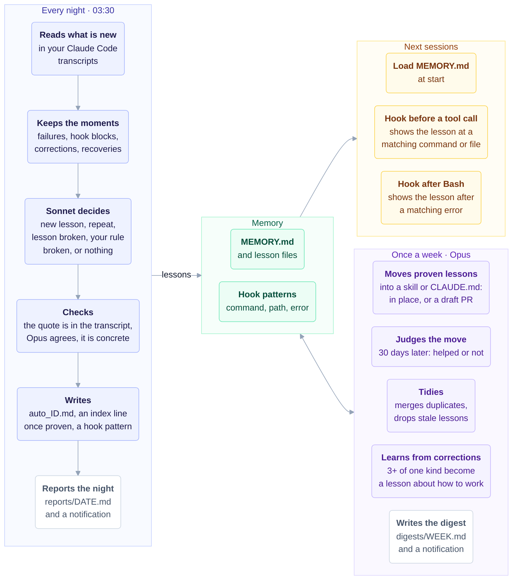
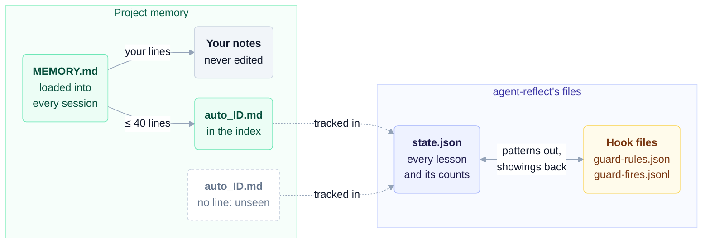
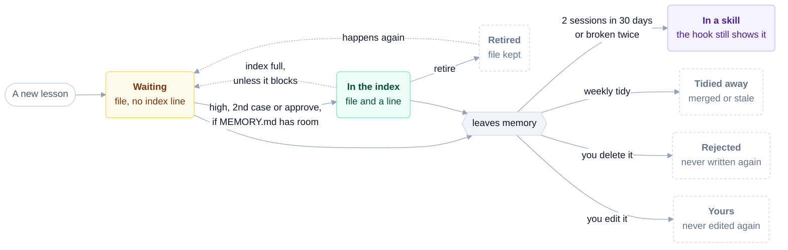

# agent-reflect

agent-reflect reads your Claude Code session transcripts every night, finds the mistakes the agent made and the work you had to send back, and writes them down as short lessons in Claude Code's memory, so the next session does not repeat them. Once a week it moves the lessons that keep coming up into your skills.

It runs locally on macOS under launchd and calls the model through your own `claude` CLI. Nothing is sent anywhere else.

## Why

An agent that got something wrong yesterday does not remember it today. You correct it, it agrees, and a week later a new session makes the same mistake: the flag that does not exist on macOS, the test run on the device you said not to touch, "done" before anything was checked. Claude Code has memory files and skills for exactly this, but someone has to write the lesson down, keep it short, and notice when it stops working.

agent-reflect does that bookkeeping. It reads what your sessions did, writes the mistakes and your corrections down as short lessons, shows each lesson to the agent at the moment it is about to repeat the mistake, and moves the lessons that keep proving themselves into your skills. What you get:

- **Fewer repeated mistakes.** A mistake the agent made in a project becomes a rule in that project's memory, written from what actually happened in the session.
- **Less work sent back.** The weekly digest counts how often you returned work ("you said it was done", "that is not what I asked") per 100 of your replies, next to a baseline you measure once over the weeks before (`agent-reflect baseline`), so you can see whether it helps.
- **The rule at the right moment.** A lesson with a trigger reaches the agent when it runs the matching command or opens the matching file, not only if it happens to read `MEMORY.md`.
- **Memory that stays small and current.** Duplicates are merged, lessons nobody needs are retired, and memory files no agent opened in a month are pointed out.
- **Skills that grow from evidence.** Only lessons confirmed across sessions reach a skill, through a draft PR you review.
- **Failures you would not see otherwise.** A hook that fails on every call, API errors the CLI retried until it gave up: counted and reported.

## How it works



## What it does

### Every night (03:30, and at login)

**Reads what is new.** Only the parts of your transcripts it has not read yet, across every project in `~/.claude/projects`, subagent transcripts included. A transcript written to in the last two hours waits for the next run.

**Finds the moments worth learning from**, before any model is called:

- a tool call that failed, and a quiet failure the tool did not report as one (`command not found`, a traceback, `Permission denied`, a non-zero exit code);
- a hook that blocked the agent;
- you rejecting a tool call or interrupting the agent;
- your replies to the agent: this is where corrections live ("no, not like that", "I already told you", "did you actually check it?");
- a recovery: the same program failed twice and then worked with a different command, the clearest sign of what the right way was.

A part of a session with none of these never reaches the model. A subagent part goes only when it holds a recovery or a hook block, because subagents fail tools all day while they look around.

**Asks the model what to remember.** Claude Sonnet, through your own `claude` CLI with no tools and no hooks, sees the part of the session (secrets scrubbed), the lessons already in memory and your `CLAUDE.md`. For each part it decides: nothing worth keeping; a new lesson; a repeat of a known lesson; a known lesson the agent broke although it was in memory; or one of your own rules broken again, which is counted against your rule rather than written as a new lesson. It also lists your corrections by kind: said "done" when it was not, broke a rule, misunderstood the task, got a tool wrong.

**Checks before writing anything.**

- A lesson quotes the transcript, and the quote must be found there.
- A second model call, on another model (Claude Opus), reads the same part and must agree that the lesson follows from it: two samples of one model tend to agree for the same wrong reason.
- A lesson about how to work, as opposed to how to use a tool, must quote you.
- A lesson too vague to act on ("be more careful with hooks") is dropped, and so is one you rejected before.

**Three kinds of lessons.** How to use a tool, how to work (read from your corrections), and a fact about the project the session paid to find out (what is generated, which stand or branch is the right one). A fact comes with how to check it again, since facts go stale.

**Writes it where Claude Code reads it.** The lesson becomes `auto_<id>.md` in that project's memory folder: when it applies, what to do, why, and the evidence. It gets a line in `MEMORY.md`, the index every session loads, only when it is high-confidence or has happened twice; the rest wait for a second case. `MEMORY.md` is kept within the limits Claude Code reads (characters, bytes, lines), with at most 40 lines of agent-reflect's own.

**Gives the lesson a trigger.** For a lesson about a command, the model proposes a regex for it; for one about a file, a regex for its path; for a mistake its command does not show (`git push` rejected, where the fix is a pull before the push), a regex for the error text. A command trigger is kept only if it matches the command that failed and not the one that worked; an error trigger only if it matches that failure's output, not the output of the command that worked, and not text every failure prints (`error`, `Exit code 1`, `Traceback`).

**Reports the night.** `reports/<date>.md` and a notification: what changed in memory (each lesson's card names the patterns the hook matches it by, a fact's way to recheck it, a command the hook refused by it, and a moved lesson whose mistake came back), what needs you (your rule broken again, a note that looks out of date, an error), what was reviewed, how much work you sent back, silent failures, and what the model calls cost.

### While you work

A hook before Bash, Edit, Write and NotebookEdit, and after Bash. When a command matches a live lesson's trigger, the agent sees the lesson right there, next to the command. When it starts editing a matching file, it sees the lesson once per session. When a shell command fails with an error that matches a lesson's error trigger, the agent sees the lesson right after it, once per session. A command the tool did not mark as failed is read only when its output shows a failure the way the nightly run sees one (`Exit code 1`, a traceback, `command not found`), and never when it only prints files or history (`cat`, `grep`, `git log`). The after-Bash hook starts at all only while some lesson has an error trigger. You can add rules of your own the same way (`agent-reflect guard add`), for every project or for one.

The hook reminds; it blocks only what you told it to. A lesson the agent broke in two sessions by a command run after the hook had already shown it there (the hook's text reaches the agent with the result of the command it fired on, so the first such command never counts) is named in the digest, and `agent-reflect guard block <id>` makes the hook refuse a command its trigger matches, with the lesson as the reason, until the agent rewrites the command (`guard unblock` lifts it). agent-reflect never turns this on by itself. Run from a Claude Code shell (`CLAUDECODE=1`), it refuses `guard block` and `guard unblock`, and every other way to take a blocking lesson away (`guard set` or `unset` on it, `retire` of it, `guard off` or `uninstall` while one blocks): you run those in your own terminal. That stops the obvious ways, not an agent set on getting around it. The weekly run never removes a blocking lesson or merges it into another. Every showing is counted, so the digest can tell which lessons are used and which only take up room.

After an update that adds hook events, run `agent-reflect guard on` once to add them to `~/.claude/settings.json`.

### Once a week

- **Moves proven lessons into skills.** A lesson confirmed in at least two sessions within 30 days, or broken twice while it sat in memory, is written into the skill or `CLAUDE.md` where it belongs. Claude Opus picks the place and the edit. Personal skills in `~/.claude/skills` are edited in place with a backup; skills and `CLAUDE.md` in the repositories you list get a draft PR, never a direct commit. An edit that reads like an incident log (dates, PR numbers, ticket keys, session ids) is refused: a skill keeps rules, not history. A project's `CLAUDE.md`, which every session loads whole, may grow by one line per edit at most: a rule that goes in takes the place of one it covers.
- **Checks that the move helped.** A moved lesson leaves memory but is still watched from that moment, while its PR waits too: its triggers, and the model, which sees it marked as moved, count every session that made its mistake again. 30 days after the move took effect (at once for a personal skill, at GitHub's merge time for a PR) it gets a verdict on the sessions started since then: cannot tell (another move, of lessons or of your notes, changed the same file in those weeks), did not help (the mistake came back), too little data (it did not, but it was in fewer than two sessions before either), or helped. A comeback inside the 30 days is reported at once; a move undone with `agent-reflect rollback`, or made after the run rolled back into the same file, is no longer checked.
- **Tidies memory.** Merges lessons that say the same thing and removes ones that no longer hold, at most a quarter of the lessons per run. The model sees each lesson's numbers (repeats, sessions in 30 days, violations, reads, hook showings) and names them in its reason. For memory entries you wrote yourself it only suggests changes.
- **Learns from repeated corrections.** Groups your corrections from the last 30 days. Three or more of one kind from at least two sessions become a lesson about how to work, at most two per project a week.
- **Looks after the lessons.** Names lessons that sat in the index for 30 days with no reads, hook showings or repeats (`agent-reflect retire` takes the line out and keeps the file), lessons the agent keeps breaking that still have no trigger, lessons broken twice although the hook showed them (`guard block`), and facts no session confirmed for 30 days, with how to check them (`agent-reflect confirm <id>` when one still holds).
- **Writes the digest.** `digests/<week>.md` and a notification: new and broken lessons, what moved into skills, the PRs, work sent back per 100 replies next to the baseline, a map of each project's memory (see [Memory](#memory)), memory files no agent opened in 30 days, silent failures, cost.

### Silent failures

Without calling a model, every run also counts hook failures and API errors that ran out of retries. When one fires 20 or more times in a night you get a notification, at most once a week for the same failure.

### What it leaves alone

- Memory files you wrote yourself are never edited. Delete an `auto_*.md` file or its index line, and that lesson is rejected for good. Edit one and it becomes yours.
- Repositories are changed only through draft PRs, and only the ones you list in the config.
- Apart from those PRs, the only thing that leaves your machine is the model calls, made through your own `claude` CLI. Secrets in transcripts (tokens, keys, passwords) are masked before the model sees them and before anything is written.
- A weekly run can be undone with `agent-reflect rollback <RUN_ID>`, and `agent-reflect reflect --dry-run` shows what a night would do without writing.

## Memory

### Where it lives



Project memory is `~/.claude/projects/<project>/memory`. `state/` (the ledger and the journal of runs, kept 60 days) and `backups/` sit in agent-reflect's own folder; the hook files are in `~/.claude/agent-reflect`.

`MEMORY.md` is kept under 190 lines and 24,000 characters, inside the 25,000 bytes Claude Code loads of it, with at most 40 lines of agent-reflect's own. When it runs over, lesson lines leave first, lowest confidence and oldest first, and those lessons wait again; a lesson that blocks a command keeps its line, and your lines are never touched.

### The path of a lesson



### In the weekly digest

Every digest draws this map for each project with lessons, with the project's own numbers:

```text
🧠 webapp
┌─ MEMORY.md · every session loads it whole ──────────┐
│ 18 lines of yours          6 lesson lines of 40     │
└───┬──────────────────────────┬──────────────────────┘
    │                          │
    ▼                          ▼
  18 files of yours          6 auto_*.md in the index
  5 not opened in 30 days    2 with a hook pattern
                             4 without one
                             + 2 auto_*.md with no line: wait for a second case

lesson path                                           now  this week
  the night's reading · corrections repeated over the week
          │ a new lesson
          ▼
  ┌──────────────┐
  │ waiting      │  a file with no line in MEMORY.md    2         +3
  └───────┬──────┘
          │ high confidence, a second case or your approve,
          │ and MEMORY.md has room
          ▼
  ┌──────────────┐
  │ in the index │  a line in MEMORY.md                 6         +1
  └───────┬──────┘
          │ confirmed in 2 sessions within 30 days, or broken 2 times
          ▼
  ┌──────────────┐
  │ in a skill   │  a rule in a skill or CLAUDE.md      3         +1
  └──────────────┘
  aside: retired 0 · tidied away 1 · rejected by you 1 · yours now 0
  back to waiting: · MEMORY.md over its limits, except a lesson that blocks a command
                   · a retired lesson happens again

🗃 MEMORY.md · webapp
   chars    █░░░░░░░░░░░░░░░░░░░  3%
   bytes    █░░░░░░░░░░░░░░░░░░░  3%
   lines    ███░░░░░░░░░░░░░░░░░  14%
   lessons  ███░░░░░░░░░░░░░░░░░  6 of 40
```

"This week" counts the lessons that came into a step on the digest's days; "with no line" files and links to missing files are memory the agent never sees.

## Requirements

- macOS (launchd, notifications)
- [Claude Code](https://claude.com/claude-code) CLI at `~/.local/bin/claude`
- Python 3.12 and [uv](https://docs.astral.sh/uv/)
- Optional: [terminal-notifier](https://github.com/julienXX/terminal-notifier) for clickable notifications (falls back to `osascript`)
- Optional: an authenticated [`gh`](https://cli.github.com/) for the weekly draft PRs

## Install

```bash
git clone https://github.com/vladislavgorbunov-afk/agent-reflect.git ~/git/agent-reflect
cd ~/git/agent-reflect
uv sync
.venv/bin/agent-reflect install
```

`install` writes two launchd agents (`local.agent-reflect.reflect` and `local.agent-reflect.consolidate`) and adds the guard hook to `~/.claude/settings.json`. On its first run it marks what is already in your transcripts as read, so it only learns from sessions after the install.

Turn off Claude Code's built-in memory consolidation, or agent-reflect will not touch memory:

```json
// ~/.claude/settings.json
{ "autoDreamEnabled": false }
```

## Configuration

Everything is optional. Without a config file agent-reflect still writes lessons and edits personal skills, and edits no repository.

`~/.config/agent-reflect/config.toml` (always this path: the launchd runs see only `HOME`):

```toml
# Language of reports, the digest, notifications and CLI output: "auto", "en" or "ru".
# "auto" (the default) takes the system's first language and falls back to English.
language = "auto"

# Keep .cursor/skills copies in step with the skills (off by default).
# Top-level keys go above the first [table]: TOML puts anything below it inside that table.
cursor_sync = false
cursor_repos = ["app"]

# Repositories whose skills (.claude/skills/*/SKILL.md, plugins/*/skills/*/SKILL.md)
# and CLAUDE.md the weekly run may change, through draft PRs.
[repos]
app = "~/git/app"
tools = "~/git/tools"

# Files where a repository keeps its test-writing rules: the weekly digest lists
# their new commits as candidates for dev-process-toolkit.
[[upstream]]
repo = "app"
paths = ["docs/TESTING.md"]
```

A config file that cannot be read stops every command with the reason, rather than running without your repositories.

The `language` setting covers what agent-reflect writes for you to read. The prompts, and so the lessons and the text the guard hook shows the agent, are in Russian for now.

## Commands

```bash
agent-reflect recent [--hours N] [-v]   # what the last night did
agent-reflect staged                    # lessons waiting for a second case
agent-reflect approve <id>              # put a waiting lesson into MEMORY.md now
agent-reflect retire <id>               # take a lesson's line out, keep its file
agent-reflect confirm <id>              # a fact was checked again and still holds
agent-reflect guard list|add|remove|set|unset|test|on|off   # --path: over a file, --error: over an error text
agent-reflect guard block|unblock <id>  # refuse a command a lesson's trigger matches
agent-reflect baseline --since YYYY-MM-DD [--dry-run]
agent-reflect rollback <RUN_ID> | --list
agent-reflect reflect --dry-run         # a night's run without writing
agent-reflect status
agent-reflect uninstall
```

State, logs, reports and digests stay inside the checkout (`state/`, `logs/`, `reports/`, `digests/`, `backups/`), and all of them are git-ignored.

## Cost

A model call reads about 50k tokens. The night's report and the weekly digest show the calls and their price at API rates. On a Claude subscription, these calls count against your usage limits instead of being billed.

## Development

```bash
uv sync
uv run --locked pytest -q
```

Tests never call the real `claude`, `gh`, `launchctl` or `terminal-notifier`.

Changes land through a pull request into `master`. The `tests` check (`.github/workflows/pr-checks.yml`) must pass on a branch that carries the latest `master`: the repository ruleset on `master` requires it and allows no direct or force push.

## License

MIT, except what is adapted from [Harness²](https://github.com/google-research/harness2) (Apache-2.0): see [third_party/harness2](third_party/harness2/NOTICE.md).
